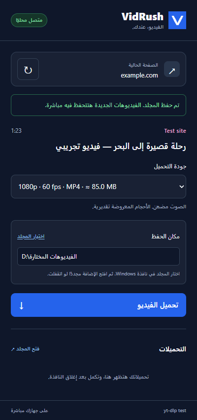
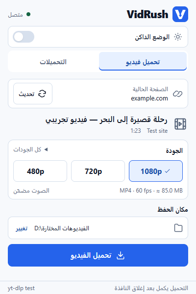
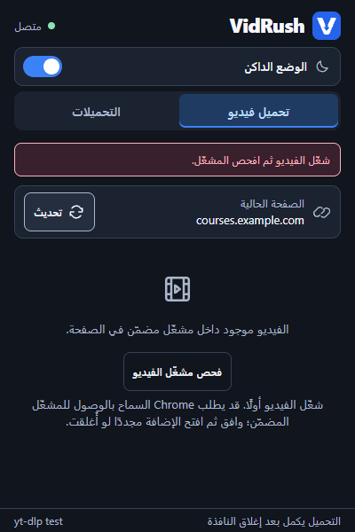
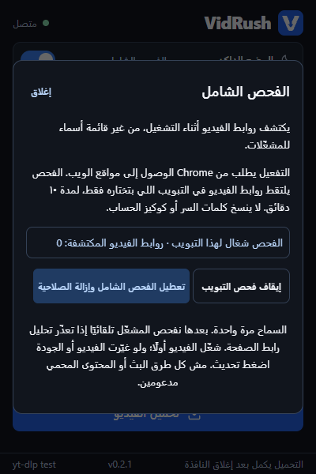

# VidRush

**Open a video page, choose a quality, and download the video to your Windows PC.**

VidRush consists of a Chrome extension and a local companion powered by [yt-dlp](https://github.com/yt-dlp/yt-dlp). The extension provides the controls; the companion analyzes the URL and downloads the file. [FFmpeg](https://github.com/yt-dlp/FFmpeg-Builds) combines video and audio when a website provides them separately.

> **Important:** VidRush supports many websites through yt-dlp. It does **not** work on every website, and it does **not** bypass DRM. This first version downloads individual videos, not playlists or live streams. The extension interface is in Arabic; this guide is in English.

 

The Rush V toolbar icon opens a compact interface with separate **Download video** and **Downloads** tabs. Both themes provide the same controls.

*Example interface with illustrative video details and file sizes.*

## Quick start — no programming knowledge needed

1. Download this project using GitHub's **Code → Download ZIP** button, then **Extract All**. Do not run setup from inside the ZIP.
2. Open the extracted folder and double-click **`Install.cmd`**. Wait while it prepares everything; no terminal commands or manual Node.js installation are needed.
3. Chrome opens a setup guide and the Extensions page. Follow the guide: turn on **Developer mode**, click **Load unpacked**, and select the installed extension folder using the **Copy folder path** button.
4. Pin VidRush from Chrome's Extensions menu, open a video page, and click VidRush to choose a quality and download.

**One file prepares all downloading tools. Chrome activation still needs your clicks once.** Chrome does not allow this unpublished extension to be silently enabled by a normal Windows installer. See [Chrome's installation rules](https://developer.chrome.com/docs/extensions/how-to/distribute/install-extensions). VidRush does not modify browser policies or profile settings to work around that restriction.

## What you can do

- Analyze the video page currently open in Chrome.
- Choose from available resolutions, frame rates, and output containers.
- Choose a download folder with the Windows folder picker; your choice is remembered.
- Download video **with audio**, including formats that require merging.
- Follow progress, cancel a download, and open the download folder.
- Close the extension popup while downloads continue. **Keep Chrome running.**

## Requirements

| Requirement | Details |
| --- | --- |
| Operating system | Windows 10 or 11, 64-bit x64 or ARM64 |
| Browser | Google Chrome 120 or newer; use a current version |
| Internet | Required for setup, video analysis, and downloading |
| Disk space | Allow about 1 GB for setup and temporary extraction, plus space for your videos |

You do **not** need Node.js, Python, npm, Git, a paid account, a server, or administrator privileges to install VidRush. `Install.cmd` reuses a compatible Node.js runtime if available, or downloads a private Node.js LTS runtime from [nodejs.org](https://nodejs.org/). It then downloads yt-dlp and FFmpeg and verifies SHA-256 hashes. The private runtime does not change your system `PATH` or replace your system Node.js.

Google Chrome itself must be installed. If it is missing, the generated guide includes the official Chrome download link; VidRush does not silently install a different browser.

## Install: step by step

### 1. Get the project

On this repository's GitHub page, click **Code → Download ZIP**. Right-click the ZIP in Windows and choose **Extract All**, then open the extracted folder. You do not need Git or a terminal.

### 2. Run the installer

1. Close Chrome, particularly before reinstalling or updating VidRush.
2. In the project folder, double-click **`Install.cmd`**.
3. Wait for the runtime, yt-dlp, and FFmpeg to download. FFmpeg is a large download; extraction can take a minute. The installer prints progress and checks each downloaded release before using it.
4. Check that the terminal says **`Installed successfully`**. If it reports an error, setup is incomplete; see [Troubleshooting](#troubleshooting).
5. Follow the setup guide opened in Chrome, then press a key to close the installer window.

You can also run setup from PowerShell in the project folder:

```powershell
.\Install.cmd
```

Do not run this as administrator. Setup registers the companion for your current Windows account.

### 3. Activate the Chrome extension once

1. Switch to the **Extensions** tab opened by setup. If it is missing, enter `chrome://extensions` in Chrome's address bar.
2. Turn on **Developer mode** in the top-right corner.
3. Click **Load unpacked**.
4. In the setup guide, click **Copy folder path**. In the folder dialog, paste the path into its address bar, press Enter, then click **Select Folder**. This selects the installed folder at `%LOCALAPPDATA%\VidRush\extension`. **Do not select the project folder or ZIP.**
5. Open Chrome's Extensions menu (the puzzle-piece button) and pin **VidRush** for easy access.

There is no extension ID to copy or paste. A checked-in public key keeps the extension ID stable, and setup registers that ID automatically. The public key is not a secret or a signing credential.

The guide is saved at `%LOCALAPPDATA%\VidRush\setup-guide.html`; double-click it to read the instructions again. The extension and companion are now in a permanent folder, so you can move or delete the original extracted project after activation. Keep or download another project copy when you want to update or uninstall.

**Upgrading from the original project-folder installation?** Remove the old VidRush entry on `chrome://extensions`, then load the permanent folder shown in the new guide. This migration is only needed once.

## Download your first video

1. Open an **individual video page** on a site supported by yt-dlp. Avoid a site's home page, search results, or a playlist page.
2. Click the **VidRush** toolbar icon.
3. Wait for the connection badge to show **`متصل`** (Connected), then wait for analysis to finish.
4. Check the video title in the **`تحميل فيديو`** (Download video) tab. Choose a quality under **`الجودة`** (Quality). Use **`كل الجودات`** (All qualities), when shown, to see the full list.
5. Under **`مكان الحفظ`** (Save location), check the displayed folder. To change it, click **`تغيير`** (Change), select your folder in Windows, then reopen VidRush if the popup closed. Your selection is saved automatically.
6. Click **`تحميل الفيديو`** (Download video). The file is saved directly into the folder shown; no move is needed afterward.
7. The **`التحميلات`** (Downloads) tab opens automatically and shows progress. You can switch between the two tabs or close the popup; keep Chrome open.
8. When the status says **`اكتمل التحميل`** (Completed), click **`فتح المجلد`** (Open folder) on that download to open its actual saved location.

The **`تحديث`** (Refresh) circular-arrow button reads the active tab's current URL each time you click it. After navigating to another video or changing pages within the same tab, press it to update the displayed site and quality choices. A delayed result from the previous page cannot replace the newer result. Use **`إلغاء`** (Cancel) beside an active download to stop it. Up to **two downloads** can run at once.

### Switch between dark and light mode

Click the switch beside **`الوضع الداكن`** (Dark mode) near the top of the popup. On means dark; off means light. VidRush starts in dark mode and remembers your choice automatically, including after you close the popup or restart Chrome. No companion connection is needed to change the theme.

### Where files are saved

By default, files go into **`VidRush` inside your Windows Downloads folder**, including a Downloads folder you relocated in Windows. For a standard account this is:

```text
C:\Users\<your-user>\Downloads\VidRush
```

The extension shows the current destination under **Save location**. Each download also keeps its own destination. In the **Downloads** tab, the Open folder button above the list opens the current default folder; a completed download's Open folder button opens that video's folder. Downloads are written by the companion, so they do **not** appear in Chrome's built-in download manager.

To change the destination:

1. Open VidRush on a video page and wait for the quality choices.
2. Click **`تغيير`** (Change) beside the save location below the quality choices.
3. Choose an existing folder, or create a new one using the Windows folder dialog, and confirm.
4. Reopen the extension if it closed while the Windows dialog had focus. Check the displayed path, then start the download.

The folder is remembered across Chrome restarts and becomes the default for new downloads. Cancelling leaves the previous setting unchanged. Existing files and downloads already in progress stay in their original folders. If the folder cannot be written to or the setting cannot be saved, VidRush reports an error and keeps the previous destination. No configuration-file editing is required.

Reinstalling preserves your selected folder. When updating an existing installation, run **`Update.cmd`** from the latest project copy, finish active downloads, then reload VidRush at `chrome://extensions` so both the interface and companion use the updated code.

File names include the source video ID and format IDs, so different qualities of the same video can be saved separately. Downloading the same choice again does not overwrite an existing file.

### Understanding quality choices and progress

- Only qualities actually reported by the website are shown. VidRush does not upscale videos.
- Up to three resolution buttons provide quick choices. **All qualities**, when shown, contains every available choice, including alternatives with the same resolution. The details below the buttons describe the selected choice's container, frame rate, and approximate size when available.
- Regular downloads use the audio and video from the same source. If an unprotected HLS or DASH stream supplies separate tracks, the companion combines them. The browser-file fallback needs a file that already contains both tracks.
- **MP4** is offered when a suitable source combination is available. Other combinations may produce **MKV**. VidRush does not re-encode the video to force MP4.
- An approximate size appears when the website provides enough information; otherwise no size is shown.
- Separate video and audio tracks download in sequence. The percentage can restart for the second track, then the status changes to merging. Wait for **Completed**, rather than a track reaching 100%.
- Cancelling may leave `.part` files or intermediate tracks. Files already on disk are not automatically deleted.

An MP4 file can contain audio only or video only. When yt-dlp leaves the codecs unknown for a direct MP4 or WebM, the companion checks the tracks with the bundled FFmpeg tools. It also checks each saved download before marking it **Completed**. If a track is missing, the job shows an error. A failed download may leave a file in the save folder.

For a standalone, unencrypted HLS playlist with unknown codecs, the companion checks a small sample from the source before offering it. Some streams announce an audio track without supplying readable sound. If a sampled source has an incomplete track, VidRush tries other detected sources. If the download changes after scanning and FFmpeg fails, VidRush checks the retained file for missing or unreadable tracks and reports what it finds.

### Reopening VidRush without scanning again

After a successful scan, close and reopen the popup on the same video page. VidRush reuses the quality list and the selected detected video. It performs a quick check of the page/player identity and the companion's saved selection, without asking yt-dlp to analyze the video again. Normal playback, unrelated captured video requests, and advertisement-frame navigation do not discard a verified result. Switching between qualities already declared by the same player also keeps the result.

Changing the page URL, replacing the video element, changing its source/declared playlist, or reloading its document triggers a fresh scan. **`تحديث`** (Refresh) always forces a new scan, even if the page looks unchanged. If a site expires a download link or exposes new qualities later, use Refresh.

The cache keeps up to **eight recent tabs** in memory during the current companion connection. It is not a permanent download-link history and is not saved to disk. Closing a tab, restarting Chrome/the companion, or reloading the extension clears its usable selections. If a selection is evicted, a browser-only file catalogue disappears, or the player identity cannot be verified, VidRush safely analyzes again. Hidden changes inside a private player API may still require Refresh.

Existing users can run **`Update.cmd`**, finish active downloads, and reload VidRush at `chrome://extensions`. Confirm **v0.2.9** in the footer. Updating enables universal DOM player discovery across modern SPA frameworks, Shadow DOM penetration, universal media attributes, and expanded manifest stream detection.

### Embedded players and signed-in lessons

If a video plays in Chrome but VidRush reports **Unsupported URL**, the page may be a wrapper around a separate player. VidRush discovers HTTP(S) frame origins dynamically, without a list of player names. It tries video elements, recent media resources, and visible player frames after normal URL analysis fails.

1. Sign in to the course website yourself and open a lesson you can watch.
2. Start the video and let it play for a few seconds. Keep the lesson page open.
3. Open VidRush. It automatically scans accessible player frames if normal page analysis fails. If the player still needs website access, **`تفعيل الفحص التلقائي`** (Enable automatic scanning) appears as a setup step.
4. Click that button once and allow Chrome's optional access to HTTP/HTTPS websites. VidRush starts scanning immediately and reuses the grant on other websites and after reopening the popup. Previously granted access to individual player sites also continues to work automatically. If Chrome closes the popup during its permission prompt, reopen VidRush. [Chrome requires a user click for the initial permission request](https://developer.chrome.com/docs/extensions/reference/api/permissions#implement_optional_permissions); VidRush cannot silently approve it.
5. Choose a quality and download. If **`الفيديو المكتشف`** (Detected video) appears, select the intended video source; a page can contain advertisements or several videos. The companion preserves the available referrer, user agent, and origin for the chosen source.



This helps with non-DRM players that expose a readable file or stream. VidRush does not sign you in or export browser cookies/passwords. A `blob:` address alone is not a downloadable file; the underlying media must be discoverable.

Saved website permissions remain managed by Chrome. Revoke the broad grant using **Comprehensive scan → Disable comprehensive scan and remove permission**, or change site access in Chrome.

### Enable comprehensive scanning once

For broader automatic detection without allowing each frame site separately:

1. Open VidRush on the video page. Click **`الفحص الشامل`** (Comprehensive scan) beside the theme controls.
2. Click **`تفعيل الفحص الشامل`** (Enable comprehensive scan). Chrome asks for access to HTTP/HTTPS websites. Approve it only if you want this optional mode; basic downloads still work without it.
3. VidRush immediately scans the current player after permission is granted. If Chrome closes the popup, reopen VidRush; it automatically analyzes the page using the saved grant. You do not need to press a player-scan button on every site. If you previously stopped capture, **`فحص التبويب الحالي`** (Scan current tab) resumes it.
4. Start the video before opening VidRush. If it started loading after the first attempt, VidRush gives an authorized player one automatic retry. Requests made before capture began may need to be repeated: restart the video, then use **`تحديث`** (Refresh) if needed. Use Refresh after changing the video or quality as well.
5. Select the detected video and quality, check your save folder, and download.



The browser remembers the site permission. Capture itself observes **one selected tab**, runs for at most **10 minutes per scan**, and stops on expiration, tab closure, or permission removal. Opening VidRush on another video tab selects that tab when the mode is enabled. **Stop scanning this tab** pauses capture until you explicitly start it again. **Disable comprehensive scan and remove permission** stops capture and removes the broad host grant. Regular downloads do not need this mode.

The detector recognizes HLS, DASH, and supported video files by their URL or response Content-Type, including URLs without a media extension. It excludes individual transport segments and keeps only bounded, temporary results. This improves coverage; it does not guarantee every website works.

### Videos served only inside the browser

Some players use a Service Worker to serve a virtual MP4/WebM address. The video plays in the page, but requesting that same address outside Chrome returns 403 or fails. When ordinary yt-dlp analysis fails, VidRush can probe a readable, non-DRM MP4/WebM in its original frame and transfer the file through Chrome to the local companion in small acknowledged chunks. The file goes into your selected save folder normally.

For these downloads, **keep the video page and Chrome open until completion**. Closing the VidRush popup is fine. Closing/navigating the source page, reloading the extension, or revoking its frame access interrupts the transfer. Cancellation may leave a `.part` file.

VidRush checks up to 16 declared files from the video element's `<source>` entries and, when available, the public JW Player playlist API. It reads a small file header to include only readable MP4/WebM files with a known size. It does not switch playback to cycle through qualities. Every option is bound to its own file and size, so selecting 720p downloads that file even if the website is currently playing another quality.

Quality names come from the player's labels when available. For example, a movie labelled **360p** may contain a cropped image only **272 pixels high**; VidRush keeps the player's 360p label instead of inventing a separate 272p quality. If the player supplies only one file and has no quality menu, VidRush offers only that file. If other files are hidden until the website switches quality, change it in the player and refresh VidRush. This is not universal quality enumeration: private player APIs, separate browser-only audio/video streams, and browser-only HLS/DASH reconstruction remain unsupported by this fallback.

## Supported websites and limits

Support comes from yt-dlp's [supported sites](https://github.com/yt-dlp/yt-dlp/blob/master/supportedsites.md) and generic extractor. Website changes, authentication, regional restrictions, and anti-bot checks can still prevent a download.

- **DRM-protected videos are unsupported.**
- Login-required, private, subscription, age-restricted, or anti-bot-protected videos may fail. This version does not import browser cookies or credentials.
- VidRush first sends the **page URL** to yt-dlp. On failure, it scans permitted frames and can use media requests captured in the selected tab. There is no player-domain allowlist. Proprietary transports, inaccessible browser responses, expired links, and authentication restrictions can still prevent downloading.
- Playlists are not downloaded as a batch. Open the individual video's own page.
- Live streams are outside the supported workflow for this version.
- Downloads survive closing the popup, but **not closing Chrome, reloading the extension, restarting the companion, sleeping the PC indefinitely, or losing the process**. Reopen the page and retry if interrupted.
- The download list lasts for the current Chrome session. This is not a permanent download-history manager.
- The installer currently supports **Windows and Google Chrome**. Other browsers and operating systems are not configured automatically.

Use VidRush for videos you own or have permission to download.

## Update

### Check which version is installed

The bottom of the VidRush popup shows its installed extension version, for example **v0.2.0**, even if the companion is disconnected. Chrome also shows it on VidRush's card at `chrome://extensions`. The nearby **yt-dlp** number belongs to the separate download engine.

Every delivered update receives a higher extension version. Fixes use a patch bump (for example, 0.2.0 → 0.2.1); new features use a minor bump (0.2.1 → 0.3.0). Pull request checks reject an unchanged or lower version and mismatched project version files.

Updating the source folder or merging a PR alone does not change the installed copy. Run **Update.cmd**, finish active downloads, then click **Reload** on VidRush at `chrome://extensions`. Reopen VidRush and check the displayed version to confirm the update was activated.

### Apply an update

**For extension/companion code updates, including folder-button fixes:**

1. Get the latest project files (`git pull`, or download and extract a fresh ZIP).
2. Double-click **`Update.cmd`**. This copies code only; it does not download tools, replace the runtime, edit your save-folder setting, or stop running downloads.
3. Wait for active downloads to finish, then open `chrome://extensions` and click **Reload** on VidRush. Reloading closes the old companion; the next popup starts the updated code. If the popup shows an old-helper warning, its **`تفعيل التحديث`** (Activate update) button reloads the extension after checking that no downloads are active.

Merging a pull request or updating the source folder alone does **not** update the installed copy. If the popup says the companion is old, run `Update.cmd` and reload the extension. The folder buttons remain disabled until the companion advertises support, so an outdated helper does not silently accept unavailable actions.

**For first-time installation or updating yt-dlp/FFmpeg/runtime files:**

1. Finish or cancel active downloads and close Chrome.
2. Update the project files (`git pull`, or replace the extracted project with a newer copy).
3. Run **`Install.cmd`** again. This installs current yt-dlp/FFmpeg releases and refreshes the companion and bundled Node.js executable.
4. The setup guide opens again. On `chrome://extensions`, click **Reload** on VidRush. If migrating from a project-folder install, remove the old entry and load the permanent folder instead.

Updates are manual. VidRush does not run an update service in the background. Setup reuses a compatible runtime; a missing or unsupported runtime is prepared automatically.

## Uninstall

1. Close Chrome.
2. Double-click **`Uninstall.cmd`** in the project folder. If you deleted that folder after installation, download and extract another copy of the project first.
3. Open `chrome://extensions` and remove **VidRush**.
4. Delete the project folder if you no longer need it.

Uninstall removes the companion and its Chrome registration. **Downloaded videos are kept.** Node.js installed separately on your PC is also kept.

If you customized `downloadDir` to point inside the companion installation folder, the uninstaller refuses to delete it. Move your videos elsewhere and update that setting before retrying.

## Troubleshooting

| Problem | What to do |
| --- | --- |
| No Node.js or programming tools are installed | That is fine: double-click `Install.cmd`. It downloads a private runtime automatically. Do not start `scripts/install.cjs` directly. |
| Setup fails to download Node.js | Check internet access to nodejs.org and rerun `Install.cmd`. A verified cached download is reused on retries. |
| Another setup is already running | Use the existing setup window and wait for it to finish before opening another one. |
| Installer fails while downloading | Check your connection and access to GitHub. Retry setup. Public GitHub API rate limits can require waiting before retrying. |
| Checksum verification fails | Do not use the downloaded file. Rerun setup; an upstream release may have changed during installation. |
| Installer cannot replace a file | Close Chrome and finish any downloads, then rerun setup. A running companion can lock its files. |
| Extension says the companion is unavailable | Run `Install.cmd` under the same Windows account as Chrome. Click `إعادة الاتصال` (Reconnect) in the popup. Check that `%LOCALAPPDATA%\VidRush\config.json` exists. |
| Chrome rejects the extension folder | Use the setup guide's Copy folder path button to select `%LOCALAPPDATA%\VidRush\extension`, rather than the project or a ZIP file. |
| Chrome or the setup tabs do not open | Open `%LOCALAPPDATA%\VidRush\setup-guide.html` manually. If Chrome is missing, use the official download link in that guide, then type `chrome://extensions` in Chrome. |
| No video or qualities found | Open the individual video page and press refresh in VidRush. Update yt-dlp by rerunning setup. The site may be unsupported or require authentication/DRM. |
| Analysis times out | Retry on the individual video's page. Analysis has a 90-second limit. Check the connection and update the companion. |
| yt-dlp says `Failed to extract` or `decompression` before analysis starts | Free space on the drive containing Windows TEMP (usually C:) and retry. The standalone yt-dlp executable needs space for its temporary runtime files. |
| Download fails with a site error | The original yt-dlp error appears in the download card. Update the companion. Authentication and anti-bot restrictions may still prevent downloading. |
| Quality list is old or selection expired | Press the circular-arrow button to analyze the page again. |
| Unsupported URL on a lesson that plays in Chrome | Start playback, reopen VidRush, and use **Scan video player** if offered. Allow access to the named player site and reopen the popup if it closed. See [Embedded players and signed-in lessons](#embedded-players-and-signed-in-lessons). |
| New/unknown player, missing scan button, or no source detected | Open **Comprehensive scan** beside the theme controls, enable it, then restart playback and refresh. Choose the correct detected source if several videos are present. |
| Browser-file download stops when leaving a page | Keep the original video page open until the download completes. Reopen, play, and refresh the video before retrying. |
| Player scan finds no source, or a stream returns 403 | Reload the lesson, start playback, and retry. Signed URLs can expire; some streams also need cookies or DRM and remain unsupported. Never paste account credentials into VidRush. |
| MP4 has sound only or picture only | Update VidRush and scan the page again. VidRush needs a source that provides both tracks. If it detects DRM, use the service's official playback options. |
| Postprocessing failed or the source has no readable audio track | Start playback, refresh VidRush, and select another detected source if available. Some HLS renditions cannot supply both tracks. The downloaded file may remain in your save folder, but it is marked failed. |
| Popup closes when choosing a folder | Finish or cancel the Windows dialog, then click VidRush again. The background connection retains your selection. |
| Folder picker is already open | Finish or cancel the existing Windows folder dialog before starting another selection. |
| Folder buttons are disabled, or the popup says the helper is old | Run `Update.cmd` from the latest project folder, finish active downloads, and activate the update or reload VidRush at `chrome://extensions`. Both installed code copies must be updated; merging alone is insufficient. |
| Open folder fails | The popup displays the Windows launch error. Check that the folder/drive exists; run `Update.cmd` and reload if using an older companion. |
| A folder cannot be saved or written to | Choose a writable folder on an available drive, check its permissions and free space, and retry. The previous folder remains selected if saving fails. |
| Download percentage restarts | Separate audio and video tracks have their own progress. Wait until the final status is Completed. |
| No download appears in Chrome's manager | This is expected. Use VidRush's Open folder button; the companion saves files directly. |
| Files stop after closing Chrome | Keep Chrome running during downloads. Re-analyze and retry after reopening it. |
| A cancelled download left files | Remove unwanted `.part` files or intermediate tracks manually once the download has stopped. |
| An existing video is not overwritten | VidRush intentionally uses yt-dlp's no-overwrite setting. Move or rename the existing file if you want a fresh download. |

## What is installed and what data is used?

The companion is installed under **`%LOCALAPPDATA%\VidRush`**, containing:

```text
VidRush/
  bin/                    yt-dlp.exe, ffmpeg.exe, ffprobe.exe
  runtime/node.exe        private runtime used by the companion
  setup-runtime/          downloaded Node.js runtime, when needed
  host/                   local companion JavaScript
  extension/              permanent copy loaded by Chrome
  setup-guide.html        final activation steps and copyable folder path
  host.cmd                Chrome's launcher
  config.json             local paths and extension ID
  com.vidrush.companion.json
```

Setup adds the current-user registry key:

```text
HKCU\Software\Google\Chrome\NativeMessagingHosts\com.vidrush.companion
```

Verified release downloads are cached in `%LOCALAPPDATA%\VidRush\cache` so a retry or reinstall can reuse the same release. Reuse requires a matching SHA-256 hash. Large releases use four partial HTTP downloads where supported. Uninstall removes this cache too.

There is no local web server or listening TCP port. Chrome starts the companion using [Native Messaging](https://developer.chrome.com/docs/extensions/develop/concepts/native-messaging). The native host manifest and companion both check the extension origin.

The extension requests `activeTab`, `scripting`, `webRequest`, `nativeMessaging`, and `storage`. There is **no required blanket website grant**. Optional HTTP/HTTPS host patterns allow Chrome to grant dynamically discovered frame sites, or all HTTP/HTTPS sites when you explicitly enable comprehensive scanning. That broader permission allows access to websites; the implementation limits network capture to the selected scan tab. `webRequest` observes responses and minimal request context without modifying/blocking requests. Cookies, passwords, request bodies, and authorization headers are not exported.

The page URL or a discovered source and validated request context is passed to the local companion for yt-dlp. Signed source URLs remain in bounded in-memory caches rather than saved job history. Persisted scan metadata contains only a tab ID and deadline; it does not include URLs. Error messages redact URL query strings. Browser-file transfers use the original page's normal browser session and Service Worker; file bytes go only to your local companion through Native Messaging. They do not export session cookies. Setup connects to nodejs.org when it needs a runtime and GitHub for yt-dlp/FFmpeg. VidRush has no analytics or remote VidRush backend.

Third-party components retain their own licenses; see [THIRD_PARTY.md](THIRD_PARTY.md).

## Development and tests

For **development only**, install Node.js 22 or newer. End users do not need this step. Clone the repository or extract its ZIP, then run from the project root:

```powershell
npm ci
npm run check
npm test
npx playwright install chromium
npm run test:browser
```

`npm ci` installs development dependencies only; end users do not need it to run VidRush. Browser tests cover the existing popup flows, permission denial/enable/stop/revoke controls, cross-origin frame isolation, generic frame origins, real webRequest capture of extensionless HLS, and ignoring media from other tabs. A localhost Service Worker fixture serves a virtual MP4 that cannot be fetched by an external downloader; the real MAIN-world transfer is checked byte-for-byte, including cancellation and cleanup. Broad test grants exist only in isolated temporary extension copies. Automated tests do not download third-party videos or use your Chrome profile.

On Windows, test setup without relying on the system Node.js runtime:

```powershell
npm run test:bootstrap
```

This downloads and verifies a real portable LTS runtime in an isolated temporary location, exercises verified-cache reuse and corrupt-cache recovery, and does not register a companion or change Chrome. For unattended local setup checks, `Install.cmd -NoOpen` prepares everything without opening browser tabs.

To run an additional end-to-end native test on Windows **after installing the companion**:

```powershell
npm run test:native
```

This generates an original test video using FFmpeg and tests real framed companion messages. A two-quality DASH stream requires the captured referrer, user agent, and origin on both manifest and segment requests. The browser-byte transport also saves the original MP4 byte-for-byte. The test persists an injected folder selection, restarts the companion, and checks real files in that Unicode folder. The graphical picker is mocked; temporary files are isolated from your regular downloads.

To additionally check that Chrome can launch the **registered** native companion:

```powershell
npm run test:browser -- --native --installed
```

This optional Windows check uses the installed companion. Keep other Chrome windows closed during this test.

See [docs/ARCHITECTURE.md](docs/ARCHITECTURE.md) for the component layout and message flow.
