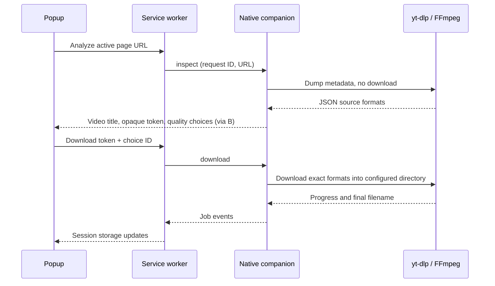

# Architecture

## Components

- `extension/popup.*`: Arabic, right-to-left UI with Video and Downloads tabs. Queries the active tab, lists exact source-format choices as quick resolution buttons and a full select, and observes session storage for job updates. Job cards are keyed by job ID so progress updates preserve keyboard focus. Untrusted video titles and errors are rendered as text.
- `extension/theme-init.js`: Applies a locally cached theme before the stylesheet loads. The popup then reads the authoritative `theme` preference from `chrome.storage.local`; a revision guard prevents a delayed read from overwriting a newer click. Only `light` and `dark` are accepted, with dark as the initial default. The preference survives browser restarts; jobs remain session-scoped. Theme changes require no native connection or additional permission.
- `scripts/generate-assets.cjs`: Reproducibly generates the approved Rush V logo as a local SVG and antialiased PNG toolbar icons without external assets or rendering dependencies. The manifest's public key and extension ID remain unchanged.
- `extension/background.js`: Manifest V3 service worker. Owns one `connectNative` port, correlates request IDs, caches up to eight video analyses, and maintains up to 30 session-scoped jobs. Closing the popup does not close the native connection.
- `extension/discovery.js`: A self-contained isolated-world function injected after page-URL extraction fails. Discovers HTTP(S) iframe origins without a player-domain allowlist, plus video elements, optional Wistia markup hints and recent Resource Timing media entries. Visible frames are ordered by area. Frames with attached MediaKeys do not yield sources. The worker validates the top document URL before/after inspection, bounds the candidate list and attempts, and exposes opaque source indexes rather than signed URLs to the popup.
- `extension/capture.js`: Read-only webRequest handlers retain at most 40 media sources and 128 pending requests for one user-selected tab. URL and response MIME detection cover MP4/WebM, HLS and DASH while excluding individual transport segments. Only referrer, user agent and origin are retained from request headers. Capture expires after ten minutes; navigation/frame replacement invalidate old requests, and tab closure or permission removal purges capture state. Only tab ID/deadline and the explicit pause flag survive worker restart in session storage; URLs and response/request bodies are never persisted there.
- `extension/browser-transfer.js` / `host/browser-download.cjs`: Generic fallback for a complete non-DRM MP4/WebM that is readable only through the page's browser/Service Worker. A MAIN-world probe validates its header and size, then document-bound reads send bounded base64 chunks via the worker's native connection. Native acknowledgements provide backpressure; byte offsets, final size, file signature and safe unique output paths are checked before completion. Cancellation/tab changes/permission loss stop the reader and leave an incomplete `.part` file rather than a completed video. HLS/DASH reconstruction in this transport is outside its scope.
- `host/index.cjs`: Validates the caller origin, reads configuration, and handles Chrome's length-prefixed UTF-8 JSON protocol.
- `host/companion.cjs`: Runs yt-dlp as a subprocess without a shell, limits concurrent analyses/downloads, parses progress, and cancels process trees on Windows.
- `host/media.cjs`: Validates web URLs and builds exact source-format choices. Private selectors remain in the companion; the UI receives opaque choice IDs.
- `host/folders.cjs` / `host/select-folder.ps1`: Opens a Windows folder dialog in an STA PowerShell process, checks the selected folder is writable, and atomically saves the default destination. Only the trusted local dialog returns a path; the extension cannot pass arbitrary output paths.
- `host/open-folder.cjs`: Launches Explorer with a visible-window request, waits for the process's spawn event, and propagates startup errors instead of silently claiming success. A completed job's directory may be recovered from the worker's session metadata after the native process restarts; this never changes a download's output path.
- `Update.cmd` / `scripts/update.ps1`: Updates installed host/extension code without touching binaries, configuration, or running jobs. Individual files are replaced atomically. The running native process retains its loaded modules until extension reload. A capability handshake exposes stale helpers, and the popup offers an activation button that checks for active downloads before invoking `runtime.reload()`.
- `scripts/install.cjs`: Derives the stable extension ID, verifies upstream release hashes, installs a local runtime and tools, and registers the native host for the current Windows user.
- `Install.cmd` / `scripts/bootstrap.ps1`: The entry point works before Node.js is installed. It reuses a compatible runtime or downloads a matching official LTS Windows ZIP, verifies SHA-256, and starts the installer. A mutex prevents overlapping setup windows. No global Node.js installation or PATH changes are required.
- `scripts/setup.cjs` / `scripts/setup-guide.html`: Copies the extension to `%LOCALAPPDATA%\VidRush\extension` and generates a local activation guide with escaped paths. Chrome opens its Extensions page beside the guide when found in standard install locations. The user enables Developer mode and loads the installed folder; setup does not change browser policies or profiles.

## Flow

## Boundaries and lifecycle

The helper accepts `ping`, `inspect`, `download`, `cancel`, `status`, `chooseFolder`, `openFolder` and the bounded `prepareBrowser`/`browserChunk`/`browserFinish`/`browserAbort` transport messages. The extension cannot submit arbitrary command-line arguments, shell commands, selectors or output paths. Referrer, user agent and origin are validated individually and bound to the native media token; a download cannot override them. yt-dlp configuration and plugin directories are ignored. URLs follow `--`.

Protocol 5 advertises `pageSources`, `sourceContext` and `browserTransfer` capabilities, with actionable update errors for missing support. Basic scanning uses activeTab and optional dynamically discovered frame origins. Comprehensive mode requests optional HTTP/HTTPS-wide host access from an explicit popup click; actual capture remains scoped to the selected tab. No cookies, passwords, authorization headers or request bodies are exported. A browser-file transfer uses the original document's normal session and Service Worker, with media bytes sent only to the local companion. URL query strings are redacted in errors. A fully resolved one-entry embed is accepted; real playlists remain unsupported.

Folder selection is owned by the service worker and companion, rather than the popup, because Chrome closes a popup when the native dialog receives focus. Selection has no fixed request deadline; it finishes when the user confirms or cancels. Session storage tracks the current folder and pending picker, and the companion persists the confirmed path in `config.json`. Cancelling and failed validation/persistence leave the old setting intact. Each job snapshots its destination when it starts; subsequent folder changes do not redirect an active job or its completion-path validation. Per-job Open folder actions resolve that snapshot by job ID in the companion.

The yt-dlp path rejects DRM and silent-only selections, and combines separate tracks with FFmpeg. The browser-file fallback rejects attached MediaKeys and saves the file as provided; it does not merge a separate audio track. Its resolution/duration come from the matching loaded video element when available, never invented quality options.

The persistent native connection keeps the service worker alive while Chrome is running. Native disconnection invalidates cached format tokens and marks active jobs as failed. Session history is kept separately in Chrome session storage; it is not a durable download database. yt-dlp network operations have a socket timeout and retry limits; analysis has a 90-second deadline, while downloads have no fixed total deadline.

Cookies and authorization headers are not retained or exported, and there is no HTTP service. Chrome handles the source page's own session during browser-file reads. The installed host checks the origin even when invoked directly. The public manifest key stabilizes unpacked extension IDs and is intentionally shared; it is not an authentication secret. Native host registration restricts callers to that ID within the current Windows account.

Setup is current-user only. Files needed to run VidRush are copied out of the source checkout, so removing the extracted project does not break the installed extension. An active companion blocks reinstallation before executables or extension files are replaced. The installer opens a local guide; Chrome's unpublished-extension activation remains an explicit user action. If Chrome is absent or installed in a nonstandard location, the guide can be opened manually and includes the official browser download link.
