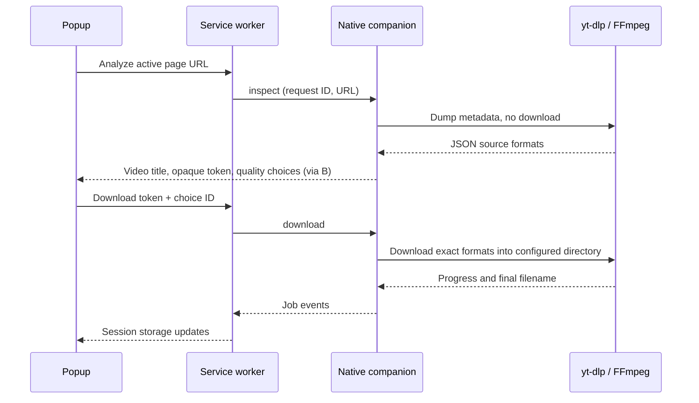

# Architecture

## Components

- `extension/popup.*`: Arabic, right-to-left UI. Queries the active tab, lists qualities, and observes session storage for job updates. Untrusted video titles and errors are rendered as text.
- `extension/background.js`: Manifest V3 service worker. Owns one `connectNative` port, correlates request IDs, caches up to eight video analyses, and maintains up to 30 session-scoped jobs. Closing the popup does not close the native connection.
- `host/index.cjs`: Validates the caller origin, reads configuration, and handles Chrome's length-prefixed UTF-8 JSON protocol.
- `host/companion.cjs`: Runs yt-dlp as a subprocess without a shell, limits concurrent analyses/downloads, parses progress, and cancels process trees on Windows.
- `host/media.cjs`: Validates web URLs and builds exact source-format choices. Private selectors remain in the companion; the UI receives opaque choice IDs.
- `scripts/install.cjs`: Derives the stable extension ID, verifies upstream release hashes, installs a local runtime and tools, and registers the native host for the current Windows user.

## Flow

## Boundaries and lifecycle

The helper only accepts `ping`, `inspect`, `download`, `cancel`, `status`, and `openFolder`. The extension cannot submit arbitrary command-line arguments, shell commands, selectors, or output paths. yt-dlp configuration and external plugin directories are ignored. HTTP(S) URLs are separated from options using `--`.

The helper rejects DRM formats and selections without audio. Separate tracks are combined with FFmpeg; compatible MP4/M4A combinations produce MP4 and other combinations produce MKV, without transcoding. Reported size is shown only when both track sizes are known.

The persistent native connection keeps the service worker alive while Chrome is running. Native disconnection invalidates cached format tokens and marks active jobs as failed. Session history is kept separately in Chrome session storage; it is not a durable download database. yt-dlp network operations have a socket timeout and retry limits; analysis has a 90-second deadline, while downloads have no fixed total deadline.

No cookies are read or transferred, and there is no HTTP service. The installed host checks the origin even when invoked directly. The public manifest key stabilizes unpacked extension IDs and is intentionally shared; it is not an authentication secret. Native host registration restricts callers to that ID within the current Windows account.
